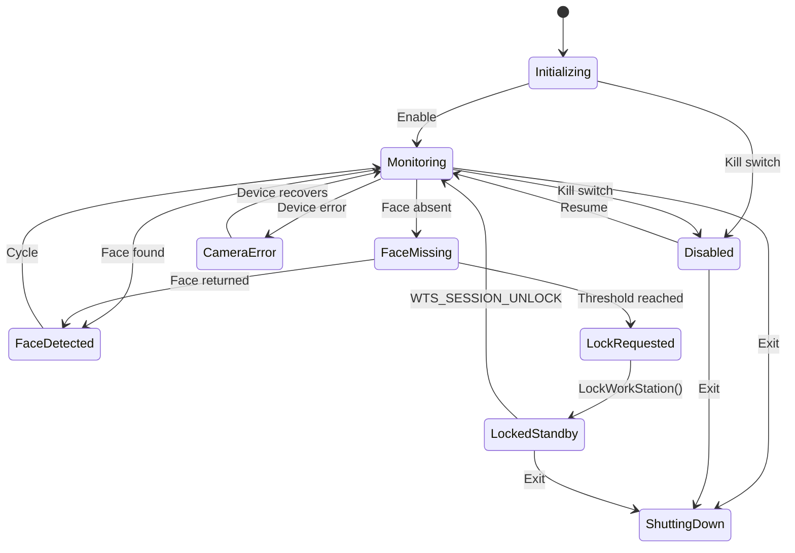

# FaceGuard — Windows Face Presence Auto-Lock

FaceGuard is a lightweight, privacy-focused, production-ready Windows desktop application built primarily in Rust. It utilizes your system's webcam and local edge neural network inference to verify physical presence, automatically locking your Windows interactive workstation whenever you step away—and crucially suspending all camera operations while locked.

---

## Key Highlights

- **Hardware Agnostic**: Works with ordinary 2D webcams and built-in laptop cameras (DirectShow / Media Foundation). No Windows Hello, infrared, or depth sensors required.
- **Privacy-Preserving**: 100% local CPU inference using a lightweight ONNX model via `tract-onnx`. Zero frames or biometric data saved or transmitted. Frames are immediately dropped from memory after single-frame inference.
- **Zero Continuous Streaming**: The camera is activated strictly for a single frame every 20 seconds (configurable) and released immediately between checks.
- **Native Windows Lock**: Integrates natively with `LockWorkStation()` via the Windows API.
- **Critical Locked Standby**: Stops the scheduler, releases all camera hardware handles, and enters an idle `LockedStandby` state upon lock.
- **Zero-Polling Session Resume**: Subscribes to native `WTSRegisterSessionNotification` events (`WM_WTSSESSION_CHANGE`). Resumes polling automatically upon `WTS_SESSION_UNLOCK` without busy-waiting.
- **False-Positive Prevention**: Configurable absence threshold (default: 2 consecutive failed checks, 40s) prevents accidental locks due to momentary head movements or lighting shifts. Camera hardware errors never trigger locks.
- **Reliable Kill Switch**: One-click emergency stop from the main dashboard or system tray immediately aborts polling and releases the webcam.
- **Standard User Privileges**: Runs entirely in the current user session without requiring administrator privileges or kernel drivers.

---

## Architecture & SOLID Principles

```text
faceguard/
├── Cargo.toml                  # Pinned dependencies & target configuration
├── build.rs                    # Tauri 2 build integration
├── tauri.conf.json             # Desktop application metadata & window geometry
├── models/
│   ├── face_detection.onnx     # Pretrained UltraFace RFB-320 ONNX model
│   └── face_detection_yunet.onnx # Pretrained YuNet ONNX model
├── resources/
│   └── icons/                  # Dynamic tray state & application icons
├── dist/                       # Embedded unslop UI assets (HTML, CSS, JS)
├── src/
│   ├── lib.rs                  # Modular core library exports
│   ├── main.rs                 # Application entry point & lifecycle management
│   ├── app.rs                  # IPC command handlers & container
│   ├── config.rs               # Configuration persistence & validation
│   ├── state.rs                # Deterministic finite state machine
│   ├── scheduler.rs            # Presence check scheduling abstractions
│   ├── camera/
│   │   ├── mod.rs
│   │   ├── device.rs           # Camera error types & descriptors
│   │   └── capture.rs          # Nokhwa MediaFoundation capture & mock capture
│   ├── detection/
│   │   ├── mod.rs
│   │   ├── model.rs            # Bounding box & detection data structures
│   │   └── detector.rs         # Tract-ONNX inference & mock detector
│   ├── windows/
│   │   ├── mod.rs
│   │   ├── lock.rs             # Native LockWorkStation() & mock locker
│   │   ├── session.rs          # WTSRegisterSessionNotification handler
│   │   └── startup.rs          # HKCU\Run auto-start registry manager
│   ├── monitoring/
│   │   ├── mod.rs
│   │   └── controller.rs       # Core orchestration controller & telemetry
│   └── ui/
│       ├── mod.rs
│       └── tray.rs             # Dynamic system tray icon & menu
└── tests/
    └── integration_tests.rs    # Comprehensive automated test suite
```

---

## State Machine

FaceGuard is built on a finite state machine:



---

## Prerequisites

- **Operating System**: Windows 10 or Windows 11 (x64)
- **Rust Toolchain**: Rust 1.88+ (`cargo`, `rustc`)
- **Webcam**: Any built-in or USB 2D camera

---

## Quick Start & Build

### 1. Build and Run Automated Tests
```powershell
cargo test
```

### 2. Compile Release Executable
```powershell
cargo build --release
```
The compiled, standalone executable is produced at:
`target\release\faceguard.exe`

### 3. Launching
```powershell
# Standard launch with UI window:
.\target\release\faceguard.exe

# Silent launch minimized in system tray:
.\target\release\faceguard.exe --minimized
```

---

## Configuration Settings

Settings are stored in `%APPDATA%\FaceGuard\config.json`:

```json
{
  "enabled": true,
  "detection_interval_seconds": 20,
  "missing_face_threshold": 2,
  "confidence_threshold": 0.70,
  "minimum_face_size": 60,
  "camera_index": 0,
  "start_with_windows": false,
  "minimize_to_tray": true,
  "notifications_enabled": true,
  "lock_on_missing_face": true,
  "grace_period_seconds": 0
}
```

| Parameter | Type | Default | Description |
| :--- | :--- | :--- | :--- |
| `enabled` | boolean | `true` | Whether face monitoring is initially active |
| `detection_interval_seconds` | integer | `20` | Interval in seconds between camera checks |
| `missing_face_threshold` | integer | `2` | Number of consecutive failed scans before locking |
| `confidence_threshold` | float | `0.70` | Neural net face confidence threshold (0.10–0.99) |
| `minimum_face_size` | integer | `60` | Minimum face width/height in pixels |
| `camera_index` | integer | `0` | Index of camera device to use |
| `start_with_windows` | boolean | `false` | Launch on user login via `HKCU\Software\Microsoft\Windows\CurrentVersion\Run` |
| `minimize_to_tray` | boolean | `true` | Minimize to tray when the close button is clicked |
| `lock_on_missing_face` | boolean | `true` | Call `LockWorkStation()` upon absence |

---

## Testing & Verification

The automated test suite verifies 9 critical subsystems without requiring physical camera hardware:
1. State machine legal & illegal transition enforcement
2. Absence threshold logic & counter reset upon face return
3. Camera error isolation (zero accidental locks during hardware disconnects)
4. Manual kill switch immediate suspension
5. Scheduler cancellation and clean shutdown
6. Native Windows lock request abstraction
7. Complete freeze of polling during `LockedStandby`
8. Automatic resume on `WTS_SESSION_UNLOCK`
9. Configuration bounds validation & corrupt JSON fallback

Run the suite anytime:
```powershell
cargo test -- --nocapture
```

---

## License

MIT License. Designed with privacy, reliability, and precision.
